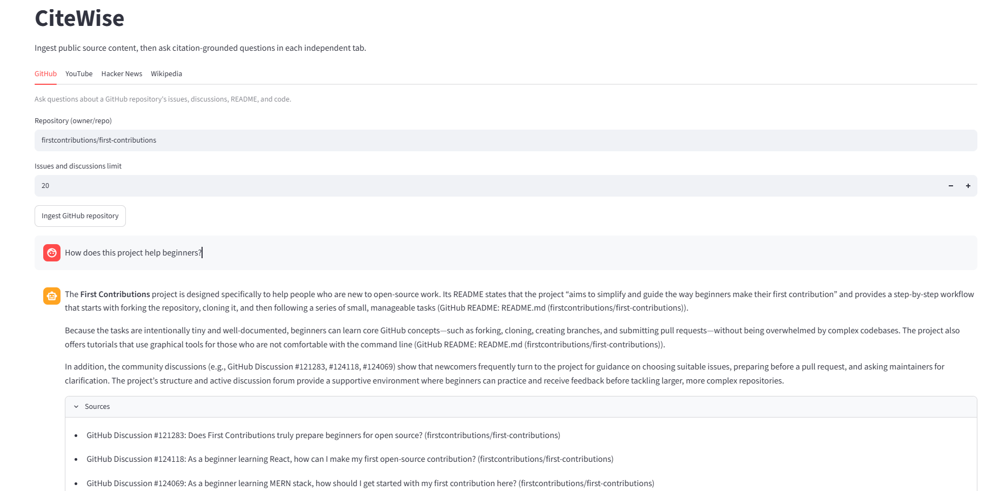
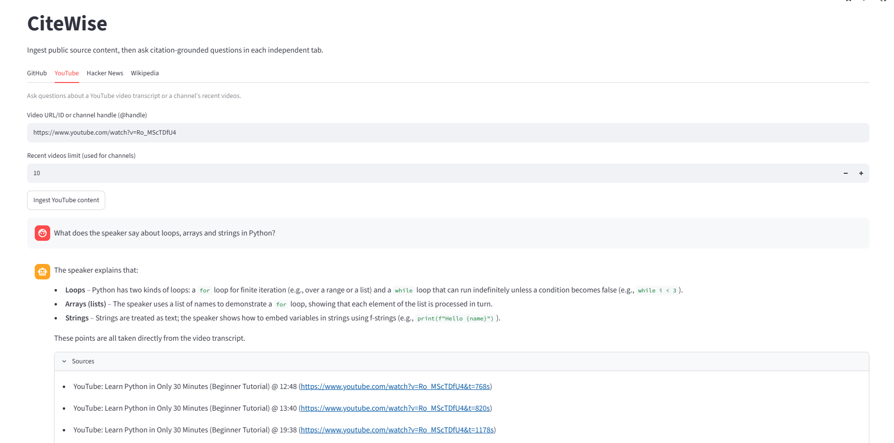
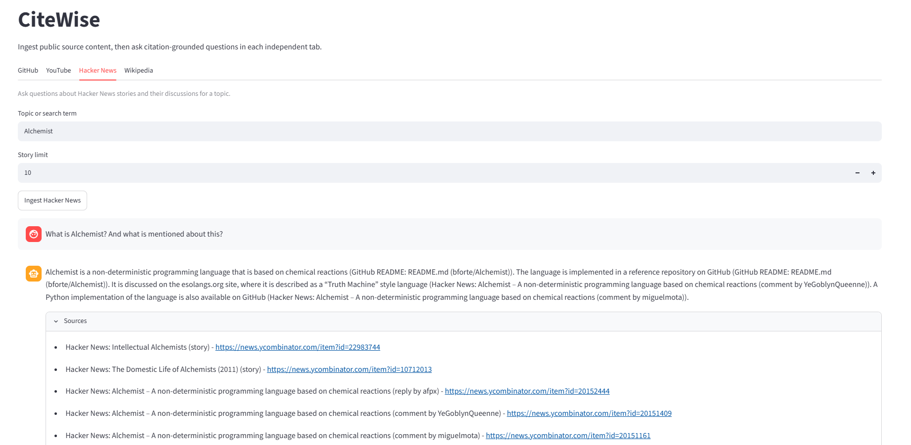
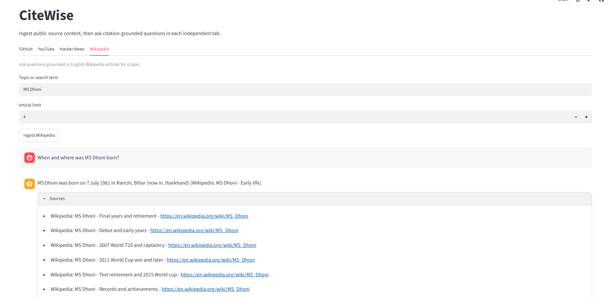

# 🔎 CiteWise

[](https://python.org)
[](https://streamlit.io)
[](https://www.langchain.com/)
[](https://www.trychroma.com/)
[](https://groq.com/)
[](https://streamlit.io/cloud)

**Multi-Source Question Answering with Cited Answers (RAG)**

*Ask questions about GitHub, YouTube, Hacker News, and Wikipedia content, and get answers with sources.*

---

## 🔗 Live Demo


> The app may take a moment to wake up. Click **Ingest** first, then ask your question.

---

## 📖 About the Project
CiteWise is a Retrieval-Augmented Generation (RAG) app built with Streamlit and Python. You choose a source (a GitHub repository, a YouTube video or channel, a Hacker News topic, or a Wikipedia topic), load its content, and then chat with it in plain English.

Every answer comes with a **Sources** section showing exactly which pieces of content were used, such as a GitHub discussion number, a YouTube timestamp, a Hacker News comment author, or a Wikipedia section. The app uses ChromaDB to store content, a local embedding model to find relevant text, and the Groq API to write the final answer.

> **What is RAG?** RAG (Retrieval-Augmented Generation) means the app first finds useful source text, then gives that text to the AI before it answers.

### 💡 Problem It Solves
A normal chatbot may not know recent or niche content, and it can make up details with full confidence. CiteWise answers only from the content you load and shows where each answer came from, so you can check it yourself instead of just trusting it.

---

## ✨ Features
- **Four Source Tabs** — Separate tabs for GitHub, YouTube, Hacker News, and Wikipedia, each working independently
- **Cited Answers** — A **Sources** box under every answer shows the content the answer was based on
- **Grounded Answers** — The AI is told to answer only from the retrieved text, and to say *"I couldn't find that answer in the retrieved source context"* when the answer isn't there
- **GitHub Support** — Loads issues, discussions, README files, and code files from a public repository
- **YouTube Support** — Works with a single video or a channel's recent videos, with timestamps in the citations
- **Hacker News Support** — Loads stories, comments, and one level of replies for any topic
- **Section-Aware Wikipedia** — Splits articles by section, so answers point to the right part of an article and skip boilerplate like *References*
- **Scoped Search** — Questions search only the content you just loaded in that tab, not everything ever stored
- **Separate Chat History** — Each tab keeps its own chat, so switching tabs never mixes conversations
- **Backup API Key Support** — Optionally uses a second Groq key if the first one hits a rate limit

---

## ⚙️ How CiteWise Works
1. The user picks a tab: GitHub, YouTube, Hacker News, or Wikipedia.
2. The user enters a source, such as a repo name, a video link, or a topic.
3. On **Ingest**, CiteWise fetches the content from that source's public API.
4. The content is split into small pieces called **chunks**. Each chunk is saved with a label (title, link, timestamp or section) that becomes its citation.
5. Each chunk is turned into an **embedding**, a list of numbers that captures the meaning of the text, and stored in ChromaDB.
6. The user asks a question in the chat box.
7. The question is turned into an embedding too, and CiteWise finds the most similar chunks, **only from the content loaded in that tab**.
8. The question and those chunks are sent to the AI (Groq) with strict "answer only from this text" rules.
9. The user gets the answer, with the sources listed below it.

```text
ON INGEST
Source content → Fetch → Split into chunks → Create embeddings → Store in ChromaDB

ON QUESTION
Your question → Find similar chunks (only from what you loaded) → Send question + chunks to AI → Grounded answer + sources
```
---

## 🛠️ Tech Stack
| Layer | Technology |
|---|---|
| Language | Python 3.12 |
| Web App / UI | Streamlit |
| RAG Toolkit | LangChain (documents, prompts, text splitting) |
| Vector Database | ChromaDB (runs locally) |
| Embeddings | sentence-transformers, `all-MiniLM-L6-v2` (runs locally, free) |
| LLM | Groq API, `openai/gpt-oss-20b` |
| GitHub Data | GitHub REST API |
| YouTube Data | `youtube-transcript-api` (captions), YouTube oEmbed (titles), `yt-dlp` (lists a channel's recent videos only) |
| Hacker News Data | Algolia Search API (find stories), Firebase API (stories, comments, replies) |
| Wikipedia Data | Wikipedia Action API (search), Wikipedia REST API (article HTML) |
| Utilities | `requests`, `python-dotenv` |
| Testing | pytest |
| Deployment | Streamlit Community Cloud |

---

## 📁 Project Structure
```bash
CiteWise/
├── app.py                          ← Streamlit app with the four source tabs
├── src/
│   └── citewise/
│       ├── config/
│       │   └── settings.py         ← Reads keys from .env or Streamlit secrets
│       ├── ingestion/              ← Fetches raw content from each source
│       │   ├── github.py
│       │   ├── hackernews.py
│       │   ├── youtube.py
│       │   ├── youtube_channel.py
│       │   ├── wikipedia.py
│       │   └── reddit_json.py, reddit_praw.py   ← Old Reddit code, kept for history
│       ├── processing/             ← Splits content into chunks and builds citations
│       │   ├── github_chunking.py
│       │   ├── hackernews_chunking.py
│       │   ├── youtube_chunking.py
│       │   └── wikipedia_chunking.py
│       ├── retrieval/
│       │   └── github_answer.py    ← Writes the answer (shared by ALL four sources)
│       ├── services/               ← Full fetch → chunk → store workflow per source
│       │   ├── github_pipeline.py
│       │   ├── hackernews_pipeline.py
│       │   ├── youtube_pipeline.py
│       │   └── wikipedia_pipeline.py
│       └── storage/
│           └── chroma_store.py     ← ChromaDB storage and similarity search
├── tests/                          ← Automated tests using fake API data
├── .env                            ← never committed
├── .env.example                    ← Example of the keys you need
├── .gitignore
├── PROJECT_NOTES.md                ← Project decisions and notes
└── requirements.txt
```
---

## 🚀 Setup and Installation
### Prerequisites
- Python 3.12+
- A free [Groq](https://console.groq.com/) API key
- *(Optional)* A [GitHub token](https://github.com/settings/tokens) for higher GitHub rate limits

### Clone the Repository
```bash
git clone https://github.com/harshitachhabria18/CiteWise.git
cd CiteWise
```

### Create and Activate Virtual Environment
```bash
python -m venv .venv

# Windows
.venv\Scripts\activate

# macOS/Linux
source .venv/bin/activate
```

### Install Dependencies
```bash
pip install -r requirements.txt
```

### Configure Environment Variables
Create a `.env` file in the root directory (never commit this file). You can copy `.env.example` to start:
```env
GROQ_API_KEY=your_groq_key_here
GROQ_API_KEY_2=
GITHUB_TOKEN=
```

| Key | Required? | Purpose |
|---|---|---|
| `GROQ_API_KEY` | **Yes** | Generates the answers |
| `GROQ_API_KEY_2` | Optional | Backup key, used if the first one hits a rate limit |
| `GITHUB_TOKEN` | Optional | Gives GitHub requests a higher rate limit |

### Run the Application
```bash
streamlit run app.py
```
Then open the local link shown in your terminal (usually [http://localhost:8501](http://localhost:8501)).

### Run the Tests
```bash
# Windows PowerShell
$env:PYTHONPATH = "src"
python -m pytest -q

# macOS/Linux
PYTHONPATH=src python -m pytest -q
```

### Deploy on Streamlit Community Cloud
1. Push the project to GitHub (make sure `.env` is **not** included).
2. On [share.streamlit.io](https://share.streamlit.io), create a new app, choose your repo and branch, and set the main file to `app.py`.
3. In **Advanced settings**, add your keys under **Secrets**:
```toml
GROQ_API_KEY = "your_groq_key_here"
GROQ_API_KEY_2 = ""
GITHUB_TOKEN = ""
```
---

## 📚 Supported Documentation Sources
| Source | You Enter | What Is Loaded | Default Limit | Example Question |
|---|---|---|---|---|
| **GitHub** | A public repo, like `psf/requests` | Issues, discussions, README, code files | 20 issues and discussions | *How does this project handle authentication?* |
| **YouTube** | A video URL, video ID, channel URL, or `@handle` | Captions from the video or a channel's recent videos | 10 channel videos | *What does the video say about the main idea?* |
| **Hacker News** | A topic or search term | Matching stories, up to 10 comments per story, up to 3 replies per comment | 10 stories | *What are developers saying about Rust?* |
| **Wikipedia** | A topic or search term | Matching English articles, split by section | 4 articles | *What are MS Dhoni's major achievements?* |

**Good to know**
- **GitHub:** Pull requests are not treated as issues. Repos with Discussions turned off are handled. Small code files stay whole, and large ones are split into pieces.
- **YouTube:** English captions are preferred. Videos with no usable captions are skipped.
- **Hacker News:** Comment loading is limited on purpose, to keep ingestion fast.
- **Wikipedia:** Sections like *References* and *External links* are not stored.
  
---

## 📸 Screenshots
### GitHub Tab


### YouTube Tab


### Hacker News Tab


### Wikipedia Tab


---

## ⚠️ Limitations
- **Temporary Storage on Streamlit Cloud** — Loaded data is lost after a restart, so users may need to click **Ingest** again
- **The AI Can Still Add Unsupported Details** — It is told to use only the source text, but important claims should be checked using the sources shown
- **YouTube Needs Captions** — Videos without captions are skipped, and timestamps mark the start of a chunk, so they can be slightly off from the exact spoken moment
- **Slow Loading for Large Sources** — Large repos and long channels take time to load
- **Search Can Miss Useful Chunks** — This can happen when many chunks are only loosely related to the question
- **Weaker for Non-English Content** — The embedding model is mainly English-focused

---

## 🔮 Future Improvements
- **Persistent Storage** — Keep loaded content after restarts using a hosted vector database
- **Clickable GitHub Citations** — Link each GitHub citation directly to the issue, discussion, or file
- **Answer Verification** — Add a second check that confirms every claim is backed by its source
- **Better Ranking** — Improve search results for large collections of content
- **Multilingual Search** — Switch to a multilingual embedding model
- **More Sources** — Add sources like podcasts
- **Cleaner Naming** — Rename `github_answer.py` to a general name that fits all sources

---

## 👨‍💻 Author
**Harshita Chhabria**


